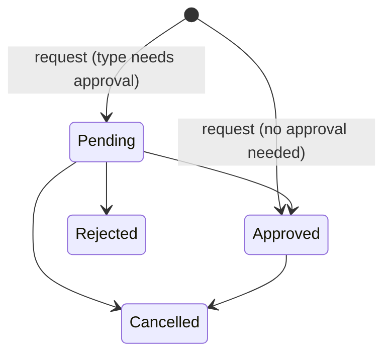

# PTO & Leave Management – Feature Specification

Oct 13, 2026 · @Gergo

## Overview

An open-source, self-hostable tool for requesting, approving and tracking paid time off and other leave within one company. This document lists features and rules only; technical decisions are out of its scope, and priorities will be set separately.

- **Audience:** any organization willing to self-host it.
- **Tenancy:** one company per installation. Multi-company support is not planned.
- **Unit of time:** days. The smallest bookable unit is half a day (0.5). Hourly leave is not supported.

## Organization structure

Teams form a single tree, and every person belongs to exactly one team.

**Teams**

- Teams are nested in a tree. A team can have sub-teams.
- A person belongs to exactly one team at a time. Moving a person to another team keeps their full history.
- Each team has a manager.
- A manager can be a member of a different team than the one they manage, for example a team lead who sits in the parent team.

**Managers**

- Every manager has a manager of their own, who approves the manager's leave. This follows the tree upwards. A configuration setting can instead allow managers to approve their own leave.
- The person at the top of the tree can create and approve their own requests.
- A manager can create leave on behalf of their team members, and approve or reject their requests.
- A manager can override policies (minimum staffing, non-bookable days) when creating or approving leave. Every override is recorded in the audit log.

**Roles**

| Role | Can do |
| --- | --- |
| Employee | Request and cancel own leave; see own balances and history; see the calendar within visibility settings |
| Manager | Everything an employee can; create, approve, reject, modify and cancel leave for their team; override policies |
| HR / Admin | Everything a manager can, for the whole company; configure leave types, schedules, holiday groups, policies; adjust balances; manage users; run reports |
| Auditor | Read-only access to calendars, balances, reports and the audit log, for example for payroll |

## Authentication and localization

- Sign-in with single sign-on (SSO) through the company's identity provider, and a basic email and password sign-in. An admin can enable either or both.
- The user interface is available in multiple languages. An admin sets the company's work language, which the interface uses by default; a user can optionally switch to another language. Content created in the app, such as leave type names, team names and holiday groups, is shown as entered and is not translated.
- Notifications (email, Slack) are sent in the recipient's language.
- Date formats follow the user's language or settings. The first day of the week is a system-wide setting, the same for everyone.
- Times and "today" follow each user's time zone, which matters for teams spread across countries.

## Working schedules

A schedule defines which weekdays a person works. Leave is only deducted for days the person would have worked.

- The company has one default schedule, for example Monday to Friday.
- A team can override the company schedule.
- An individual user can have a schedule that overrides their team's, for example a 4-day week. Only an admin can create or assign such a schedule; employees cannot change their own by default.
- The most specific schedule wins: user over team over company.
- Schedules have an effective-from date. When a person switches from 5 to 4 days in June, leave before June is still calculated with the 5-day schedule.
- Changing a schedule never changes leave that was already taken.

## Holiday groups

Public holidays are managed through holiday groups instead of storing a person's country or region. A person can be assigned to several groups, and their holidays are the combined days of all their groups.

- An admin creates groups such as "Hungary", "Germany – Bavaria" or "Company days".
- Each group holds a list of dated holidays, with a name for each.
- A group can contain full-day and half-day holidays (for example, half a day on Christmas Eve).
- Groups can be assigned to a whole team, and individual people can have extra groups.
- People on the same team can have different groups, so a team spread across countries sees each member's holidays correctly.
- A holiday reduces the leave deducted only when it falls on one of the person's working days. Example: a person working 4 days books a week containing a holiday on one of those days, so 3 days are deducted.
- Company-specific days off (for example, a company-wide closing day) are a holiday group like any other.
- Holidays are kept per year inside a group, because national and religious holidays can change from year to year. Group assignments carry over every year, so teams and people never need to be re-assigned. An admin sets each year's dates, optionally copying the previous year as a starting point. Editing one year never changes past years, so history stays as it was.
- Optional per group: a substitute day when a holiday falls on a non-working day, for countries that grant one.

## Leave types and balances

Leave types are fully configurable by an admin; the system ships with sensible defaults (vacation, sick leave, unpaid leave) that can be edited or removed.

**Leave type settings**

- Name and a color for the calendar. The name is entered once, in any language, and is not translated.
- Whether it counts against a balance, or is unlimited.
- Whether it needs approval, or is approved automatically.
- Whether an attachment is required, for example a doctor's note, optionally only above a number of days.
- Whether half days are allowed.
- Whether the reason is private (see Calendar and visibility).
- Which teams or people the type is available to.
- A type can be archived; past leave of that type stays in history and reports.

**Allowances**

- An annual allowance per leave type, set at company level and overridable per team and per person.
- Accrual model per type: the full amount at the start of the leave year, or monthly accrual.
- Optional extra days by tenure, for example +1 day after 5 years.
- The leave year is configurable: calendar year or a custom start month.
- Pro-rating for people who join or leave mid-year, and for part-time schedules. HR can override any pro-rated amount.

**Carry-over**

- A maximum number of days carried into the next leave year, per type.
- An expiry date for carried-over days, for example March 31.
- Carried-over days are used first.

**Balance rules**

- Manual balance adjustments by HR, each with a required comment, recorded in the audit log.
- Leave that spans two leave years (for example, Dec 28 to Jan 5) draws each day from the allowance of the year it falls in.
- Each person sees per type: allowance, carried over, taken, planned (approved but in the future), pending and remaining.

## Leave requests and approval

An employee requests leave, their manager approves or rejects it, and HR can act on any request.

**Creating a request**

- Pick a leave type, a start and end date, and optionally a comment and attachments.
- For half days, choose morning or afternoon. A half day can be placed directly before or after a full-day leave or holiday.
- Before submitting, the request shows how many days will be deducted, after removing non-working days and holidays, and the balance remaining afterwards.
- Requests that break a rule are blocked with a clear reason: insufficient balance, a non-bookable day, a blackout period, or minimum staffing.
- Managers and HR can create leave on behalf of someone else, and can override blocking rules. Overrides are recorded.

**Statuses**

- Pending → Approved or Rejected.
- Pending or Approved → Cancelled.
- A rejection can carry a comment.
- Leave types that don't need approval go straight to Approved.

Approved leave can still be shortened, extended or converted to another type by a manager or HR without leaving the Approved status.

**Approval**

- The default approver is the requester's team manager. A manager's own leave goes to their manager.
- HR can approve or reject any request.
- Optional multi-level approval for selected leave types or long absences (for example, manager then HR).
- A request always goes to the manager; the employee does not choose an approver. If the manager is away, the request stays pending and the manager approves it on return, even if the leave has already started.
- Reminders are sent to approvers about requests still pending after a configurable time.

**Changing approved leave**

- The employee can cancel future leave they created themselves. Leave created by a manager or HR can only be cancelled by a manager or HR. Leave for days already passed, of any type, cannot be removed by the employee; only a manager or HR can remove it.
- A manager or HR can shorten, extend or cancel leave that is already in progress.
- A manager or HR changes the type of some days (for example, sick days during a vacation) by shortening or editing the existing leave and creating a new one with the other type. There is no dedicated conversion feature; days removed from a leave return to its balance.
- Every change recalculates the balance and is recorded in the audit log.

## Coverage rules

Three rules protect availability. Each blocks an employee's request, and a manager or HR can override it.

**Minimum staffing**

- Each team can set a minimum number of members who must be present on any working day.
- A request that would bring the team below the minimum is blocked for the employee.
- A manager or HR can still create or approve the leave, overriding the rule.

**Blackout periods**

- Date ranges in which leave cannot be requested, for example month-end close for finance.
- Defined company-wide or per team.
- Optionally limited to certain leave types (sick leave is usually exempt).

**Non-bookable days**

- Single days that cannot be booked as leave, for example a company event.
- Hard block for employees; a manager or HR can still create a leave record on that day.

## Calendar and visibility

A company-wide monthly board shows who is away, and privacy settings control how much each viewer sees.

**Company board**

- Monthly view of everyone's leave, with holidays, weekends and non-working days marked per person.
- Filters by team (including sub-teams), by person and by leave type.
- Pending requests are shown differently from approved leave.
- Blackout periods and non-bookable days are visible on the board.

**Personal dashboard**

- Balances per leave type (see Leave types and balances).
- Upcoming leave, pending requests and full history.
- For managers: requests waiting for their approval and the team's upcoming absences.

**Privacy**

- Colleagues see that a person is away, but not the leave type or reason, when the type is marked private (for example sick or parental leave).
- The requester, their approvers, HR and auditors always see full details.
- Configurable visibility of the board: the whole company, own team only, or own leave only.

**Calendar feeds**

- iCal feed per person, per team and for the whole company, to subscribe to in Google Calendar, Outlook or similar.
- Feeds respect the privacy settings above.

## Notifications and integrations

Every event can be delivered by email, Slack and webhook; users choose which events they receive by email and Slack.

**Events**

| Event | Default recipients |
| --- | --- |
| Request submitted | Approver |
| Request approved / rejected | Requester |
| Leave created on someone's behalf | That person |
| Leave changed or cancelled | Requester and approver |
| Request still pending (reminder) | Approver |
| Balance adjusted by HR | That person |
| Carried-over days about to expire | That person |

**Channels**

- **Email** for all events.
- **Slack**: direct messages for personal events, and a configurable team or company channel for approved leave.
- **Slack status**: set a person's status to out of office while they are on leave.
- **Daily or weekly digest** ("who's out today / this week") to a Slack channel or by email, per team or company-wide.
- **Webhooks**: an admin registers URLs and picks the events each one receives.

**API**

- A REST API covering users, teams, leave, balances and reports, for integration with payroll or HR systems.

## Administration and reporting

HR and admins configure the system, manage users and pull data for payroll; auditors get read-only access to the same data.

**Configuration**

- Company settings: name, default language, leave year start, default working schedule.
- Leave types, allowances, carry-over and accrual rules.
- Holiday groups, blackout periods and non-bookable days.
- Team tree, managers and minimum staffing per team.
- Notification channels and webhooks.

**User management**

- Add, edit and close user accounts.
- Assign team, role, working schedule and holiday groups.
- Bulk import of users and opening balances from CSV, for migrating from a spreadsheet.

**Reports**

- Leave taken per person, team and leave type over any period.
- Remaining balances for everyone, at any date.
- Absence trends over time per team or type.
- Leave of a given type in a period, for example last month's unpaid leave for payroll.
- Export of every report to CSV and Excel.

**Year-end close**

- Applies carry-over rules and opens the new leave year's allowances.
- Shows a preview before it runs; can be run manually or on a set date.

**Audit log**

- Records who created, approved, rejected, changed, cancelled or overrode what, and when.
- Records balance adjustments and configuration changes.
- Searchable and exportable; it cannot be edited.

## Employee lifecycle

People join, move and leave; their allowances follow automatically and their history is never lost.

**Joining**

- A user can join in two ways:
  1. **Invited by HR:** HR creates the user with their email address. The user then signs in with SSO, or sets a password through a password reset.
  2. **First sign-in with SSO:** the user signs in with SSO before HR has created them. The account waits for HR approval; HR approves it and assigns a team. Until then the user cannot request leave or see anything else in the app.
- A start date is set for each new user.
- The allowance for the first leave year is pro-rated from the start date by default; HR can override it.

**Changes during employment**

- Moving to another team keeps all leave history and balances.
- A schedule change applies from its effective date (see Working schedules); allowances for the rest of the year are re-pro-rated, with HR able to override.
- Holiday groups can be changed with an effective date.

**Leaving**

- An end date is set; the allowance for the final year is pro-rated to that date.
- The system shows the remaining balance at the end date, for payout or deduction in payroll.
- Future leave after the end date is cancelled.
- The account is closed: the person can no longer sign in, and they disappear from active lists and the board.
- The account is soft-deleted only: their history stays available in reports and the audit log.

## Reference use cases

These scenarios define the expected behavior and serve as acceptance checks.

| # | Scenario | Expected outcome |
| --- | --- | --- |
| 1 | A person on a 4-day schedule books a week that contains a public holiday from their holiday group, falling on one of their working days. | 3 days are deducted. |
| 2 | A manager is on vacation while requests from their team are pending. | HR can approve or reject them; otherwise the request stays pending until the manager returns. |
| 3 | Someone gets sick during an approved vacation. | The manager or HR shortens or cancels the vacation and records sick leave for those days; the vacation balance is restored. |
| 4 | An employee joins on September 15 with a 25-day annual allowance. | They get a pro-rated allowance by default; HR can override it. |
| 5 | Two of three people on a team request the same week. | With a minimum staffing of 1, both are allowed. With a minimum of 2, the second request is blocked for the employee, but a manager or HR can add it, overriding the rule. |
| 6 | HR needs last month's unpaid leave for payroll. | A report filtered by leave type and period, exportable to CSV or Excel. |
| 7 | An employee leaves with 4 days unused. | The remaining balance is shown at the end date; the account is closed and soft-deleted, and stays available in reports. |
| 8 | A vacation runs from December 28 to January 5. | Days before January 1 come from the old year's allowance, the rest from the new year's. |
| 9 | A team manager wants a week off. | The request goes to the manager's own manager; at the top of the tree, the person approves it themselves. |

## Out of scope

- Hourly leave; the smallest unit is half a day.
- Overlap warnings between teammates (minimum staffing covers availability instead).
- Naming a backup person who covers during leave.
- Multiple companies on one installation.
- Storing a person's country or region; holiday groups replace this.
- A person belonging to more than one team.
- Negative leave balances; a balance can never go below zero.
- Delegate approvers, and choosing an approver when submitting a request.
